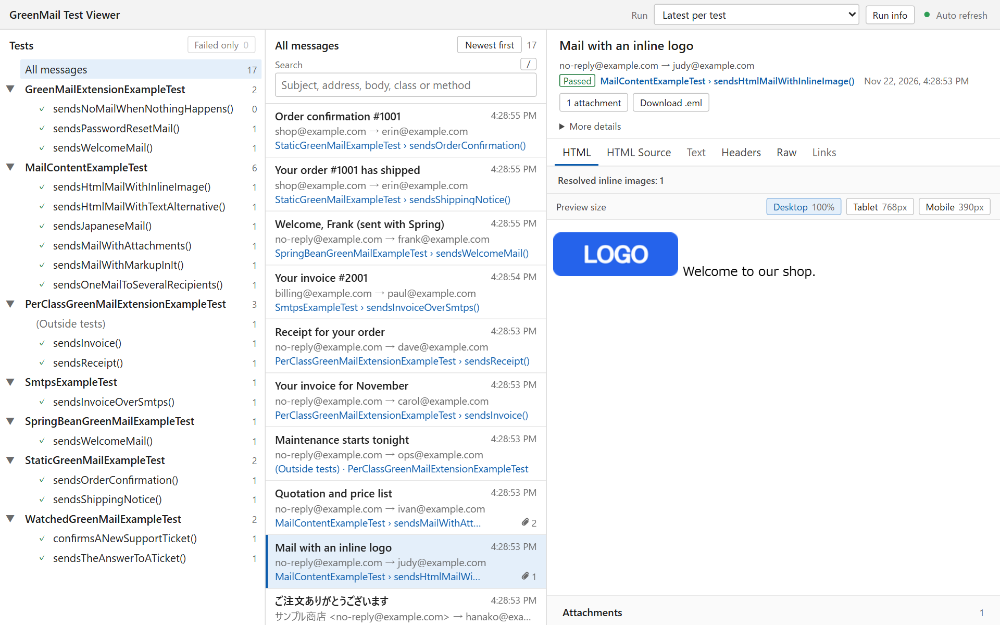
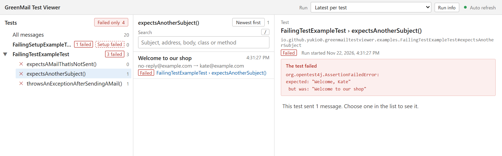

# GreenMail Test Viewer

[English](README.md) | 日本語

JUnit のテストが [GreenMail](https://greenmail-mail-test.github.io/greenmail/) に送ったメールを、送ったテストのクラス・メソッドと一緒に見られます。

テストクラスにアノテーションを 1 つ付けるだけです。テストを実行すると、GreenMail が受け取ったメールがテストごとに記録されます。あとはブラウザでビューアを開き、クラスとメソッドからたどって見ます。HTML のプレビュー、テキスト、ヘッダ、添付ファイル、メールの元の形（raw）を見られます。メール版の JUnit の HTML レポートのようなものです。



- **どのテストが送ったメールかがわかります。** それぞれのメールを、送ったテストと結び付けます。`@Nested`・`@ParameterizedTest`・`@RepeatedTest`・`@ParameterizedClass`・`@TestFactory` の動的テストにも対応しています。`@BeforeAll` やテストの合間に送ったメールは、別に分けて表示します。
- **GreenMail の使い方は変えなくてかまいません。** 拡張がテストクラスのフィールドから GreenMail を見つけます。`GreenMailExtension`、自分で起動する `GreenMail`、Spring の Bean のどれでもかまいません。
- **サーバではなく、ファイルに残します。** 記録は `build/`（Gradle）か `target/`（Maven）の中のファイルです。ビューアは別のプログラムなので、テストが終わったあとでも開けます。ビューアの依存がテストのクラスパスに入ることもありません。CI のビルドの記録も、ダウンロードして同じように開けます（[CI で送られたメールを見る](#ci-で送られたメールを見る)）。
- **テストごとに、いちばん新しい結果を表示します。** IDE で 1 つのテストクラスだけを流しても、ほかのテストは前回の結果のまま表示されます。
- **テストを失敗させません。** 記録の途中で問題が起きたとき（ファイルが書けないなど）は、拡張は警告を出すだけで、テストはいつもどおり動きます。

## 動作環境

| | 対応 |
| --- | --- |
| Java | 11 以上（テスト、ビューア、プラグインを使う Gradle） |
| GreenMail | 2.1.x（2.1.0 以上） |
| プロトコル | GreenMail が SMTP か SMTPS で受け取ったメール |
| JUnit | 5.6 以上 |
| Gradle | 8.0 以上（ビューアを起動する Gradle のプラグイン） |
| Maven | 3.6.3 以上（exec-maven-plugin でビューアを起動するとき） |

## 使い始める

### 1. 拡張を追加する

拡張は、テストのクラスパスにすでにある JUnit と GreenMail を使います。まだプロジェクトにないときは、自分で追加してください。

Gradle（`build.gradle`）：

```groovy
dependencies {
  testImplementation 'io.github.yukio0:greenmail-test-viewer-junit-jupiter:0.1.0'
}
```

Gradle の Kotlin DSL（`build.gradle.kts`）：

```kotlin
dependencies {
  testImplementation("io.github.yukio0:greenmail-test-viewer-junit-jupiter:0.1.0")
}
```

Maven（`pom.xml`）：

```xml
<dependency>
  <groupId>io.github.yukio0</groupId>
  <artifactId>greenmail-test-viewer-junit-jupiter</artifactId>
  <version>0.1.0</version>
  <scope>test</scope>
</dependency>
```

### 2. テストクラスにアノテーションを付ける

GreenMail を使っているテストクラスに `@GreenMailTestViewer` を付けます。GreenMail の書き方はそのままでかまいません。

GreenMail の `GreenMailExtension` を使う場合：

```java
import io.github.yukio0.greenmailtestviewer.jupiter.GreenMailTestViewer;

@GreenMailTestViewer // テストクラスに足すのはこれだけ
class SignupMailTest {

  @RegisterExtension
  static GreenMailExtension greenMail = new GreenMailExtension(ServerSetupTest.SMTP);

  @Test
  void sendsWelcomeMail() throws Exception {
    signupService.signup("user@example.com");

    assertThat(greenMail.getReceivedMessages()).hasSize(1);
  }
}
```

テストクラスが自分で起動する `GreenMail` や、Spring のテストでフィールドに受け取る GreenMail の Bean でも同じです。拡張は、テストクラスのフィールドから GreenMail を見つけます。見つからなければ警告を出します（[拡張のログ](#拡張のログ)を参照）。共通の親クラスに `@GreenMailTestViewer` を付けると、すべての子クラスに効きます。

### 3. テストを実行する

いつもどおりテストを実行します。記録は、各モジュールの `build/greenmail-test-viewer/`（Gradle）か `target/greenmail-test-viewer/`（Maven）に書かれます。

### 4. ビューアを開く

プロジェクトのルートのフォルダでビューアを起動します。起動したフォルダから下にある全モジュールの記録を見つけ、<http://127.0.0.1:3080/> に表示します。数秒おきに新しい記録を探すので、開いたままテストを実行できます。ビューアの起動中に初めて記録を書いたモジュールは、表示されるまで最大 30 秒かかります。

#### Gradle の場合

ビルドのタスクとして起動します。ルートのプロジェクトのビルドスクリプトに、拡張と同じ版のプラグインを足します。

`build.gradle`：

```groovy
plugins {
  id 'io.github.yukio0.greenmail-test-viewer' version '0.1.0'
}
```

`build.gradle.kts`：

```kotlin
plugins {
  id("io.github.yukio0.greenmail-test-viewer") version "0.1.0"
}
```

```bash
./gradlew greenmailTestViewer
```

タスクは、ブラウザでビューアを開き、Ctrl+C で止めるまで動き続けます。手でダウンロードするものはありません。プラグインは、自分と同じ版のビューアを、ルートのプロジェクトのリポジトリ（Maven Central など）から取ってきます。ルートのプロジェクトにリポジトリがなければ、そのビルドスクリプトか、`settings.gradle`・`settings.gradle.kts` の `dependencyResolutionManagement` に書きます。

#### Maven の場合

exec-maven-plugin で起動します。ルートのプロジェクトの `pom.xml` に、拡張と同じ版のビューアを依存に持つプラグインを足します：

```xml
<build>
  <plugins>
    <plugin>
      <groupId>org.codehaus.mojo</groupId>
      <artifactId>exec-maven-plugin</artifactId>
      <version>3.6.4</version>
      <configuration>
        <mainClass>io.github.yukio0.greenmailtestviewer.viewer.ViewerMain</mainClass>
        <includeProjectDependencies>false</includeProjectDependencies>
        <includePluginDependencies>true</includePluginDependencies>
        <arguments>
          <argument>--open</argument>
        </arguments>
      </configuration>
      <dependencies>
        <dependency>
          <groupId>io.github.yukio0</groupId>
          <artifactId>greenmail-test-viewer</artifactId>
          <version>0.1.0</version>
        </dependency>
      </dependencies>
    </plugin>
  </plugins>
</build>
```

```bash
mvn exec:java
```

`mvn exec:java` は、ブラウザでビューアを開き、Ctrl+C で止めるまで動き続けます。ビューアは Maven が Maven Central から取ってきます。プラグインの依存なので、テストのクラスパスには入りません。マルチモジュールのプロジェクトでは、全モジュールの記録が見つかるように、ルートのフォルダで実行します。

#### ビルドツールを使わない場合

[リリース](https://github.com/yukio0/greenmail-test-viewer/releases)から `greenmail-test-viewer.jar` をダウンロードして実行します：

```bash
java -jar greenmail-test-viewer.jar --open
```

## ビューアの見方

左のペインは、クラスとテストメソッドのツリーです（モジュールが 2 つ以上あるときは、モジュールの下に並びます）。各テストに結果と送ったメールの数が付きます。ツリーの上の **Failed only** で、失敗したテストだけを表示できます。真ん中のペインにはツリーで選んだものに属するメールが並び、上部の **Search** で、その件名・宛先・本文・テスト名を検索できます（`/` で検索欄に移ります）。右のペインには、メールとそれを送ったテスト、または選んだテストやクラスの結果とエラーが出ます。



テストごとのいちばん新しい結果の代わりに 1 つの実行を見るときは、上部の **Run** でその実行を選びます。

| 表示 | 意味 |
| --- | --- |
| `Earlier run` | モジュールの最新の実行より古い結果です。今回はそのテストを流さなかった、クラスごと無効にした、などのときに出ます。マウスを重ねると、その実行の日時が出ます。 |
| クラスの `Setup failed`、そのテストの `Class setup failed` | 最新の実行で `@BeforeAll`（またはほかの拡張の `beforeAll`）が失敗し、テストが実行されませんでした。前の結果は、今の結果としては表示しません。 |
| クラスの `Teardown failed` | `@AfterAll` が失敗しました。テストの結果はそのままです。 |
| クラスの `Setup aborted`・`Teardown aborted` | `@BeforeAll` か `@AfterAll` の前提（`Assumptions.assumeTrue` など）が成り立ちませんでした。失敗には数えません。`Setup aborted` のとき、そのテストは `Aborted` になります。 |
| `(Outside tests)` | クラスの実行中に、どのテストにも属さずに受け取ったメールです。`@BeforeAll`・`@AfterAll` やテストの合間に送ったものなどです。 |
| `(Outside test classes)` | テストクラスが始まる前に受け取ったメールです。前のクラスと共有している GreenMail に届いたものなどです。 |
| `(Ambiguous)` | 複数のテストが同時に同じ GreenMail を使っていたときに受け取ったメールです。候補のテストを一緒に表示します。 |

テストが失敗すると、拡張は、そのテストをビューアで開くリンクを、テストの出力の失敗のそばにログで出します：

```text
INFO: sendsWelcomeMail() failed. See its emails in GreenMail Test Viewer: http://127.0.0.1:3080/#test=...
```

開くと、そのテストの結果、エラー、メールが見られます。ビューアを別の場所で動かしているときは、`greenmail.testviewer.viewer-url` を設定します（[設定](#設定)を参照）。Gradle では、[拡張のログ](#拡張のログ)の設定をしたときだけ、リンクがコンソールに出ます。

## フィールドにない GreenMail を登録する

ヘルパークラスが持っているなど、GreenMail がほかの場所にある場合は、`GreenMailTestViewerExtension.watch` で登録します。登録した GreenMail は、ガベージコレクションで回収されるまで、拡張を使うすべてのテストクラスで使われます。登録しても、ガベージコレクションの妨げにはなりません。

```java
@GreenMailTestViewer
class OrderMailTest {

  static MailTestSupport mail = new MailTestSupport(); // GreenMail を持っている

  @BeforeAll
  static void watchMailServer() {
    GreenMailTestViewerExtension.watch(mail.greenMail());
  }
}
```

## すべてのテストクラスで有効にする

クラスごとにアノテーションを付ける代わりに、JUnit にすべてのテストクラスで拡張を登録させることもできます。`src/test/resources/junit-platform.properties` に次を足します：

```properties
junit.jupiter.extensions.autodetection.enabled=true
```

GreenMail のないクラスでは、拡張は何もしません。ただし、この設定は、テストのクラスパスにあるほかのライブラリが自動で登録させている拡張も有効にします。どのテストが記録されるかがコードを見てわかるので、クラスにアノテーションを付ける方法をおすすめします。

## 設定

| 設定 | 既定値 | 意味 |
| --- | --- | --- |
| `greenmail.testviewer.output-dir` | `build/greenmail-test-viewer`。テストの作業フォルダに `pom.xml` があれば `target/greenmail-test-viewer` | 記録を書く場所。相対パスは、テストの作業フォルダ（モジュールのフォルダ）からの位置です。プロジェクトの外にしたときは、そのフォルダを `--dir` でビューアに渡します（[ビューアのオプション](#ビューアのオプション)を参照）。 |
| `greenmail.testviewer.keep-runs` | `20` | 残す実行（終わったもの）の数。古い実行は、テストが始まるときに消します。 |
| `greenmail.testviewer.viewer-url` | `http://127.0.0.1:3080` | ビューアが動いている場所。テストが失敗すると、拡張はここでそのメールを開くリンクをログに出します。`none` にするとリンクを出しません。 |
| `@GreenMailTestViewer(asyncWaitMillis = ...)` | `0` | 非同期で送られるメールを、各テストメソッドと、`@TestFactory` のメソッドの各動的テストのあとで待つ時間（[制限](#制限)を参照）。 |

アノテーション以外は、JUnit の設定です。`src/test/resources/junit-platform.properties` に書きます：

```properties
greenmail.testviewer.keep-runs=5
```

テストの JVM のシステムプロパティで渡すこともできます。

### 古い実行

テストが表示されるのは、残している実行（`keep-runs`）にそのテストがあるあいだだけです。同じ一部のテストだけを何度も流すと、ほかのテストの結果は古い実行と一緒に消えます。`./gradlew clean` や `mvn clean` で、`build/` や `target/` の中の記録は消えます。ビューアは何も消しません。

### 拡張のログ

拡張は、メッセージをテストの標準エラーに出します。見つけた GreenMail、警告、失敗したテストのメールを開くリンクです。Maven と IDE では、テストの出力と一緒に表示されます。Gradle は、テストのレポート（`build/reports/tests/test/`）には残しますが、コンソールには出しません。コンソールや CI のログで見るには、テストのあるモジュールの `build.gradle` に次を足します：

```groovy
tasks.named('test') {
  testLogging {
    events 'failed', 'standard_error'
  }
}
```

## CI で送られたメールを見る

CI でテストが失敗したとき、そのテストが送ったメールを見ると、理由がわかることがよくあります。記録をビルドの成果物（artifact）として残し、ダウンロードして `--dir` でビューアに渡します。

GitHub Actions では、テストのあとにアップロードします：

```yaml
      - run: ./gradlew build

      # テストが失敗したときにも残す（メールが要るのはそのとき）
      - uses: actions/upload-artifact@v7
        if: ${{ !cancelled() }}
        with:
          name: greenmail-test-viewer
          path: '**/build/greenmail-test-viewer/'
          retention-days: 7
```

Maven では、パスは `**/target/greenmail-test-viewer/` です。ほかの CI でも同じで、記録のフォルダを成果物として残します。

実行のページ（下の **Artifacts**）からダウンロードし、`ci-emails` などのフォルダに展開します。そのフォルダを渡して、ビューアを起動します。渡したフォルダだけを読むので、手元で流した実行の記録は混ざりません。

```bash
./gradlew greenmailTestViewer --dir=ci-emails
```

```bash
mvn exec:java "-Dexec.args=--open --dir ci-emails"
```

```bash
java -jar greenmail-test-viewer.jar --open --dir ci-emails
```

成果物は、リポジトリを読める人なら誰でもダウンロードできます。記録には、テストが送ったメールがそのまま入っています。

Gradle のビルドキャッシュを使っていると、結果をキャッシュから戻したテストのタスク（`FROM-CACHE`）は、テストを実行しないので、メールを記録しません。CI のような新しい作業場所には、メールが何も残りません。メールを記録するテストのタスクは、キャッシュから戻さないようにします：

```groovy
tasks.named('test') {
  outputs.doNotCacheIf('GreenMail Test Viewer records emails while the tests run') { true }
}
```

1 回のビルドだけなら、`./gradlew test --rerun` で実行し直すこともできます。

## ビューアのオプション

| オプション | 既定値 | 意味 |
| --- | --- | --- |
| `--dir <directory>` | カレントフォルダ | 記録を探す場所。記録のあるフォルダは、目印のファイルで 8 階層の深さまで探します。記録のあるフォルダそのものを指定することもできます。複数指定できます。 |
| `--host <address>` | `127.0.0.1` | 待ち受けるアドレス。ビューアには認証がないので、このアドレスにアクセスできる人は誰でもメールを読めます。 |
| `--port <port>` | `3080` | 待ち受けるポート。`0` にすると空いているポートを使います。 |
| `--allowed-host <name>` | | このホスト名への要求にも応えます。ポートは付けずに書きます（`myhost:3080` ではなく `myhost`）。複数指定できます。 |
| `--open` | | 起動したら、このマシンの既定のブラウザでビューアを開きます。コンテナの中などブラウザを開けないときは、開く URL をログに出します。 |
| `--block-remote-css-and-fonts` | | HTML のプレビューで、ほかのサーバのスタイルシートとフォントを読み込みません。Mailpit の同じ名前のオプションと同じです。ほかのサーバの画像は表示します。 |
| `--help` | | オプションの一覧を表示します。 |

Gradle のプラグインでは、ビルドスクリプトの `greenmailTestViewer` のブロックで設定します：

```groovy
greenmailTestViewer {
  port = 9000
  open = false
}
```

`build.gradle.kts` でも、Gradle 8.2 以降なら同じブロックで書けます。Gradle 8.0・8.1 では、`port.set(9000)`・`open.set(false)` と書きます。

| 設定 | コマンドラインでの指定 | 既定値 |
| --- | --- | --- |
| `directories` | `--dir` | プロジェクトのフォルダ |
| `host` | `--args=--host=<address>` | `127.0.0.1` |
| `port` | `--port` | `3080` |
| `allowedHosts` | `--args=--allowed-host=<name>` | |
| `open` | `--no-open`、`--open`（Gradle 8.2 以降） | `true` |
| `viewerVersion` | | プラグインの版 |

`directories` の相対パスは、プロジェクトのフォルダから見たものです。コマンドラインでは、タスクのオプション `--dir`・`--port`・`--no-open`・`--open` が、ビルドスクリプトの設定より優先されます。ほかのオプション（`--host` や `--block-remote-css-and-fonts` など）は `--args` でビューアに渡します：

```bash
./gradlew greenmailTestViewer --port=9000 --no-open
./gradlew greenmailTestViewer --args=--block-remote-css-and-fonts
```

exec-maven-plugin では、オプションを `<arguments>` に書くか、コマンドラインの `-Dexec.args` で置き換えます（例：`mvn exec:java "-Dexec.args=--open --port 9000"`）。

`java -jar` では、ビューアのオプションを jar の後ろに付けます（例：`java -jar greenmail-test-viewer.jar --port 9000`）。この場合、ブラウザは `--open` を付けたときだけ開きます。

## 制限

- **1 つの GreenMail を共有して、並列に実行するテスト。** どのテストがメールを送ったかを拡張が区別できないので、そのメールは候補のテストと一緒に `(Ambiguous)` と表示します。GreenMail を共有するテストは、順番に実行してください。自分の GreenMail を自分のポートで動かすテストは、並列に実行してもかまいません。たとえば、static でない `GreenMailExtension` のフィールドで、`ServerSetupTest.SMTP.dynamicPort()` を使います。
- **非同期で送るメール。** テストメソッドが終わったあとに届いたメールは、テストごとに GreenMail を止める場合（`GreenMailExtension` の既定）は失われます。GreenMail を共有している場合は、あとのテストのものか `(Outside tests)` として記録されます。`@GreenMailTestViewer(asyncWaitMillis = 500)` で待ってください。拡張は、指定した時間をいつも最後まで待ちます。`@TestFactory` のメソッドでは、各動的テストのあとにも待ち、メソッドのあとにもう一度待ちます。
- **この拡張より前に登録した拡張**（`@GreenMailTestViewer` より前の `@ExtendWith` のもの）。その拡張の `afterAll` での失敗は記録されません。その拡張の `InvocationInterceptor` が動的テストの結果を変えると、ビューアは JUnit と違う結果を表示します。その拡張の `@ExtendWith` より前に `@GreenMailTestViewer` を書いてください。

## 対応していないもの

- STARTTLS、IMAP、POP3
- ずっと動かしておく SMTP サーバとしての使い方（Mailpit を使ってください）
- ビューアでのメールの送信、既読にすること、削除
- 認証（ビューアにアクセスできる人は、誰でもメールを読めます）
- JUnit 4、TestNG

## ライセンス

[Apache License 2.0](LICENSE)
