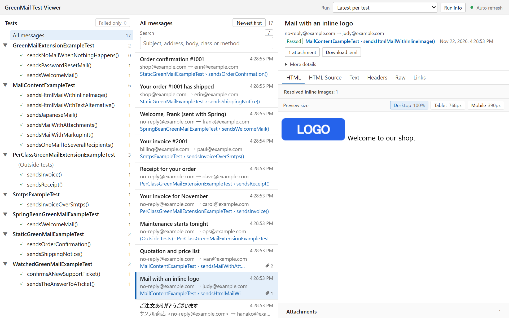
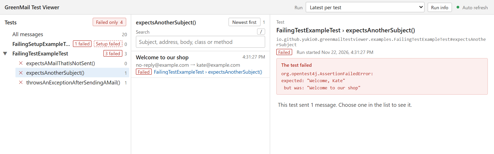

# GreenMail Test Viewer

English | [日本語](README-ja.md)

See the emails your JUnit tests send to
[GreenMail](https://greenmail-mail-test.github.io/greenmail/), together with the test class and
method that sent them.

Add one annotation to a test class. When the tests run, the emails that GreenMail receives are
recorded for each test. Then open the viewer in a browser to browse them by class and method, with
an HTML preview, the text, headers, attachments and the raw message. Think of it as the JUnit HTML
report for emails.



- **Knows which test sent each email.** Each email is tied to the test that sent it, including
  tests in `@Nested` classes, `@ParameterizedTest`, `@RepeatedTest`, `@ParameterizedClass` and
  the dynamic tests of `@TestFactory`. Emails sent in `@BeforeAll` or between tests are shown
  separately.
- **No change to your GreenMail setup.** The extension finds GreenMail instances in the fields of
  the test class: `GreenMailExtension`, a `GreenMail` you start yourself, or a Spring bean.
- **Files, not a server.** The records are files in `build/` (Gradle) or `target/` (Maven). The
  viewer is a separate program, so it can be opened after the tests have finished, and none of its
  dependencies enter your test classpath. The records of a CI build can be downloaded and opened
  the same way ([Emails sent in CI](#emails-sent-in-ci)).
- **The latest result of every test.** Run one test class from the IDE, and the viewer still shows
  the other tests from their last run.
- **Never fails your tests.** If something goes wrong while recording, such as a file that cannot
  be written, the extension logs a warning and the tests run as usual.

## Requirements

| | Supported |
| --- | --- |
| Java | 11 or later, for the tests, the viewer, and Gradle when you use the plugin |
| GreenMail | 2.1.x (2.1.0 or later) |
| Protocols | Emails that GreenMail receives over SMTP or SMTPS |
| JUnit | 5.6 or later |
| Gradle | 8.0 or later, for the Gradle plugin that starts the viewer |
| Maven | 3.6.3 or later, for starting the viewer with exec-maven-plugin |

## Getting started

### 1. Add the extension

The extension uses the JUnit and GreenMail dependencies already on your test classpath. Add them if
your project does not have them yet.

Gradle (`build.gradle`):

```groovy
dependencies {
  testImplementation 'io.github.yukio0:greenmail-test-viewer-junit-jupiter:0.1.0'
}
```

Gradle Kotlin DSL (`build.gradle.kts`):

```kotlin
dependencies {
  testImplementation("io.github.yukio0:greenmail-test-viewer-junit-jupiter:0.1.0")
}
```

Maven (`pom.xml`):

```xml
<dependency>
  <groupId>io.github.yukio0</groupId>
  <artifactId>greenmail-test-viewer-junit-jupiter</artifactId>
  <version>0.1.0</version>
  <scope>test</scope>
</dependency>
```

### 2. Annotate your test classes

Add `@GreenMailTestViewer` to the test classes that use GreenMail. Leave your GreenMail setup as
it is.

With GreenMail's `GreenMailExtension`:

```java
import io.github.yukio0.greenmailtestviewer.jupiter.GreenMailTestViewer;

@GreenMailTestViewer // the only change to the test class
class SignupMailTest {

  @RegisterExtension
  static GreenMailExtension greenMail = new GreenMailExtension(ServerSetupTest.SMTP);

  @Test
  void sendsWelcomeMail() throws Exception {
    signupService.signup("user@example.com");

    assertThat(greenMail.getReceivedMessages()).hasSize(1);
  }
}
```

The same goes for a `GreenMail` that the test class starts itself, or a GreenMail bean injected
into a field of a Spring test. The extension finds GreenMail instances in the fields of the test
class, and warns if it finds none (see [Extension logs](#extension-logs)).
`@GreenMailTestViewer` on a common superclass applies to all its subclasses.

### 3. Run the tests

Run the tests as usual. The records are written to `build/greenmail-test-viewer/` (Gradle) or
`target/greenmail-test-viewer/` (Maven) in each module.

### 4. Open the viewer

Start the viewer in the root directory of your project. It finds the records of all modules below
the directory where it starts, and shows them at <http://127.0.0.1:3080/>. It checks for new records
every few seconds, so you can keep it open while you run tests.

#### With Gradle

Start the viewer as a task of your build. Add the plugin to the build script of the root project,
with the same version as the extension.

`build.gradle`:

```groovy
plugins {
  id 'io.github.yukio0.greenmail-test-viewer' version '0.1.0'
}
```

`build.gradle.kts`:

```kotlin
plugins {
  id("io.github.yukio0.greenmail-test-viewer") version "0.1.0"
}
```

```bash
./gradlew greenmailTestViewer
```

The task opens the viewer in your browser, and runs until you stop it with Ctrl+C. There is
nothing to download by hand: the plugin fetches the viewer of the same version from the
repositories of the root project, such as Maven Central. If no repositories are configured for the
root project, declare them in its build script or in the `dependencyResolutionManagement` block of
`settings.gradle` or `settings.gradle.kts`.

#### With Maven

Start the viewer with exec-maven-plugin. Add the plugin to the `pom.xml` of the root project, with
the viewer as its dependency, at the same version as the extension:

```xml
<build>
  <plugins>
    <plugin>
      <groupId>org.codehaus.mojo</groupId>
      <artifactId>exec-maven-plugin</artifactId>
      <version>3.6.4</version>
      <configuration>
        <mainClass>io.github.yukio0.greenmailtestviewer.viewer.ViewerMain</mainClass>
        <includeProjectDependencies>false</includeProjectDependencies>
        <includePluginDependencies>true</includePluginDependencies>
        <arguments>
          <argument>--open</argument>
        </arguments>
      </configuration>
      <dependencies>
        <dependency>
          <groupId>io.github.yukio0</groupId>
          <artifactId>greenmail-test-viewer</artifactId>
          <version>0.1.0</version>
        </dependency>
      </dependencies>
    </plugin>
  </plugins>
</build>
```

```bash
mvn exec:java
```

`mvn exec:java` opens the viewer in your browser, and runs until you stop it with Ctrl+C. Maven
fetches the viewer from Maven Central. As a dependency of the plugin, it does not enter your test
classpath. In a multi-module project, run it in the root directory, so that it finds the records of
all modules.

#### Without a build tool

Download `greenmail-test-viewer.jar` from the
[releases](https://github.com/yukio0/greenmail-test-viewer/releases) and run:

```bash
java -jar greenmail-test-viewer.jar --open
```

## Using the viewer

The left pane is a tree of classes and test methods, under their modules when there is more than
one, with the result of each test and how many emails it sent. **Failed only** above the tree
shows only the failed tests. The middle pane lists the emails for the item selected in the tree,
and **Search** at the top searches their subjects, addresses, bodies and test names (press `/` to
jump to it). The right pane shows an email with the test that sent it, or the result and the error
of the selected test or class.



To see a single run rather than the latest result of each test, choose it in **Run** at the top.

| Label | Meaning |
| --- | --- |
| `Earlier run` | The result is older than the latest run of the module, for example because the test did not run this time, or its class was disabled. Hover over it to see the date of that run. |
| `Setup failed` on a class, `Class setup failed` on its tests | `@BeforeAll` (or another extension's `beforeAll`) failed in the latest run, so the tests did not run. Their earlier results are not shown as current. |
| `Teardown failed` on a class | `@AfterAll` failed. The results of the tests stay as they are. |
| `Setup aborted` or `Teardown aborted` on a class | An assumption in `@BeforeAll` or `@AfterAll` did not hold (for example `Assumptions.assumeTrue`). It is not counted as a failure. After `Setup aborted`, its tests are shown as `Aborted`. |
| `(Outside tests)` | Emails received while the class ran but outside any test, for example in `@BeforeAll`, `@AfterAll`, or between tests. |
| `(Outside test classes)` | Emails received before a test class started, for example by a GreenMail instance shared with an earlier class. |
| `(Ambiguous)` | Emails received while several tests used the same GreenMail instance at the same time. The possible tests are listed. |

When a test fails, the extension logs a link to it in the viewer, next to the failure in the output
of the test:

```text
INFO: sendsWelcomeMail() failed. See its emails in GreenMail Test Viewer: http://127.0.0.1:3080/#test=...
```

Open it to see the result, the error and the emails of the test. If the viewer runs elsewhere, set
`greenmail.testviewer.viewer-url` (see [Configuration](#configuration)). Gradle shows the link on
the console only with the setting in [Extension logs](#extension-logs).

## Registering a GreenMail instance that is not in a field

If the GreenMail instance is held somewhere else, for example by a helper class, register it with
`GreenMailTestViewerExtension.watch`. A registered instance is used by every test class that has
the extension, until it is garbage collected. Registering it does not prevent garbage collection.

```java
@GreenMailTestViewer
class OrderMailTest {

  static MailTestSupport mail = new MailTestSupport(); // holds a GreenMail

  @BeforeAll
  static void watchMailServer() {
    GreenMailTestViewerExtension.watch(mail.greenMail());
  }
}
```

## Enabling the extension for every test class

Instead of annotating each class, you can let JUnit register the extension for every test class.
Add this to `src/test/resources/junit-platform.properties`:

```properties
junit.jupiter.extensions.autodetection.enabled=true
```

The extension does nothing in classes without GreenMail. This setting also turns on the extensions
that other libraries on the test classpath register for automatic detection. Annotating the classes
is recommended, because the code then shows which tests are recorded.

## Configuration

| Setting | Default | Meaning |
| --- | --- | --- |
| `greenmail.testviewer.output-dir` | `build/greenmail-test-viewer`, or `target/greenmail-test-viewer` if the working directory of the tests has a `pom.xml` | Where to write the records. A relative path is resolved against the working directory of the tests (the module directory). If the output directory is outside the project, pass its path to the viewer with `--dir` (see [Viewer options](#viewer-options)). |
| `greenmail.testviewer.keep-runs` | `20` | How many finished runs to keep. Older runs are deleted when the tests start. |
| `greenmail.testviewer.viewer-url` | `http://127.0.0.1:3080` | Where the viewer runs. When a test fails, the extension logs a link to its emails there. `none` turns the link off. |
| `@GreenMailTestViewer(asyncWaitMillis = ...)` | `0` | How long to wait after each test method, and after each dynamic test of a `@TestFactory` method, for emails sent asynchronously (see [Limitations](#limitations)). |

The first three are JUnit configuration parameters. Put them in
`src/test/resources/junit-platform.properties`:

```properties
greenmail.testviewer.keep-runs=5
```

They can also be passed as system properties of the test JVM.

### Old runs

A test is shown only as long as one of the kept runs (`keep-runs`) has it. If you run the same few
tests over and over, the results of the other tests disappear with the old runs.
`./gradlew clean` or `mvn clean` deletes the records in `build/` or `target/`. The viewer never
deletes anything.

### Extension logs

The extension writes its messages to the tests' standard error: the GreenMail instances it found,
its warnings, and the link to the emails of each failed test. Maven and IDEs show them with the
output of the tests. Gradle keeps them in the test report (`build/reports/tests/test/`), but does
not show them on the console. To see them there, and in the log of a CI build, add this to the
`build.gradle` of the modules with tests:

```groovy
tasks.named('test') {
  testLogging {
    events 'failed', 'standard_error'
  }
}
```

## Emails sent in CI

When a test fails in CI, the emails it sent often show why. Keep the records as an artifact of the
build, download them, and give them to the viewer with `--dir`.

With GitHub Actions, upload them after the tests:

```yaml
      - run: ./gradlew build

      # Upload even when tests fail, which is when you need the emails.
      - uses: actions/upload-artifact@v7
        if: ${{ !cancelled() }}
        with:
          name: greenmail-test-viewer
          path: '**/build/greenmail-test-viewer/'
          retention-days: 7
```

With Maven, the path is `**/target/greenmail-test-viewer/`. Other CI services work the same way:
keep the records directory as an artifact.

Download the artifact from the run's page (under **Artifacts** at the bottom) and unzip it into a
directory, such as `ci-emails`. Then start the viewer on that directory. It reads only the
directory it is given, so the records of your own runs are not mixed in.

```bash
./gradlew greenmailTestViewer --dir=ci-emails
```

```bash
mvn exec:java "-Dexec.args=--open --dir ci-emails"
```

```bash
java -jar greenmail-test-viewer.jar --open --dir ci-emails
```

Anyone who can read the repository can download its artifacts, and the records contain the
emails exactly as the tests sent them.

With the Gradle build cache, a test task whose results come from the cache (`FROM-CACHE`) does
not run its tests, so it records no emails, and a fresh workspace, as in CI, ends up with none.
Keep the test tasks that record emails out of the cache:

```groovy
tasks.named('test') {
  outputs.doNotCacheIf('GreenMail Test Viewer records emails while the tests run') { true }
}
```

Or rerun them for a single build with `./gradlew test --rerun`.

## Viewer options

| Option | Default | Meaning |
| --- | --- | --- |
| `--dir <directory>` | the current directory | Where to look for records. Directories with records are found by their marker file, up to 8 levels deep. A directory with records can also be given directly. Can be given more than once. |
| `--host <address>` | `127.0.0.1` | The address to listen on. The viewer has no authentication, so anyone who can reach this address can read the emails. |
| `--port <port>` | `3080` | The port to listen on. `0` picks a free port. |
| `--allowed-host <name>` | | Also answer requests for this host name, given without a port (`myhost`, not `myhost:3080`). Can be given more than once. |
| `--open` | | Open the viewer in the default browser of this machine once it runs. Where no browser can be opened, such as in a container, the viewer logs the address to open instead. |
| `--block-remote-css-and-fonts` | | Keep the HTML preview from loading style sheets and fonts from other servers, like the option of the same name in Mailpit. Images on other servers are still shown. |
| `--help` | | Show the options. |

With the Gradle plugin, set the options in the `greenmailTestViewer` block of the build script:

```groovy
greenmailTestViewer {
  port = 9000
  open = false
}
```

The block is the same in `build.gradle.kts` with Gradle 8.2 or later. With Gradle 8.0 and 8.1,
write `port.set(9000)` and `open.set(false)` there.

| Setting | On the command line | Default |
| --- | --- | --- |
| `directories` | `--dir` | the project directory |
| `host` | `--args=--host=<address>` | `127.0.0.1` |
| `port` | `--port` | `3080` |
| `allowedHosts` | `--args=--allowed-host=<name>` | |
| `open` | `--no-open`, `--open` (Gradle 8.2 or later) | `true` |
| `viewerVersion` | | the version of the plugin |

Relative paths in `directories` are resolved against the project directory. On the command line, the
options `--dir`, `--port`, `--no-open` and `--open` of the task take precedence over the build
script, and `--args` passes any other option to the viewer, such as `--host` or
`--block-remote-css-and-fonts`:

```bash
./gradlew greenmailTestViewer --port=9000 --no-open
./gradlew greenmailTestViewer --args=--block-remote-css-and-fonts
```

With exec-maven-plugin, set the options in `<arguments>`, or replace them on the command line
with `-Dexec.args`, such as `mvn exec:java "-Dexec.args=--open --port 9000"`.

With `java -jar`, put the options of the viewer after the jar, such as
`java -jar greenmail-test-viewer.jar --port 9000`. In that case, the browser opens only with
`--open`.

## Limitations

- **Tests that run in parallel and share one GreenMail instance.** The extension cannot tell which
  of them sent an email, so such emails are shown as `(Ambiguous)` with the possible tests. Run the
  tests that share an instance one after another. Tests that each have their own GreenMail
  instance on their own port can run in parallel, for example with a non-static
  `GreenMailExtension` field and `ServerSetupTest.SMTP.dynamicPort()`.
- **Emails sent asynchronously.** An email that arrives after the test method has ended is lost
  when GreenMail is stopped after each test (the default of `GreenMailExtension`), or is recorded
  for a later test or as `(Outside tests)` when GreenMail is shared. Wait for it with
  `@GreenMailTestViewer(asyncWaitMillis = 500)`. The extension always waits for the full configured
  duration. For a `@TestFactory` method, it waits after each dynamic test and again after the
  factory method itself.
- **Extensions registered before this one**, with an `@ExtendWith` before `@GreenMailTestViewer`.
  Failures in their `afterAll` are not recorded, and if their `InvocationInterceptor` changes the
  result of a dynamic test, the viewer shows a different result from JUnit. Put
  `@GreenMailTestViewer` before their `@ExtendWith`.

## Not supported

- STARTTLS, IMAP and POP3
- Running as an always-on SMTP server (use Mailpit for that)
- Sending, marking as read, or deleting emails in the viewer
- Authentication (anyone who can reach the viewer can read the emails)
- JUnit 4 and TestNG

## License

[Apache License 2.0](LICENSE)
